# Guía rápida — Módulo de Compras

Esta guía muestra paso a paso cómo registrar un **proveedor**, cargar una **compra** (al contado o a crédito) y usar las funciones principales del módulo. Todas las capturas son del sistema real (`https://nutriesteticans.neura.com.py`) con la cuenta de administrador.

---

## Antes de empezar

- Ingresá al ERP con tu usuario **Admin**.
- Si no ves **Compras** en el menú de la izquierda, avisá a soporte: el módulo debe estar habilitado para la empresa.
- Todos los datos que cargues quedan guardados en la base de tu empresa.

---

## Paso 1 — Abrí el módulo de Compras

En el menú izquierdo, buscá la sección **OPERACIONES → Compras**. Al tocar/clicar se despliegan tres opciones:

- **Compras** → facturas de proveedor registradas.
- **Órdenes de compra** → pedidos pendientes de recibir.
- **Proveedores** → listado y alta de proveedores.

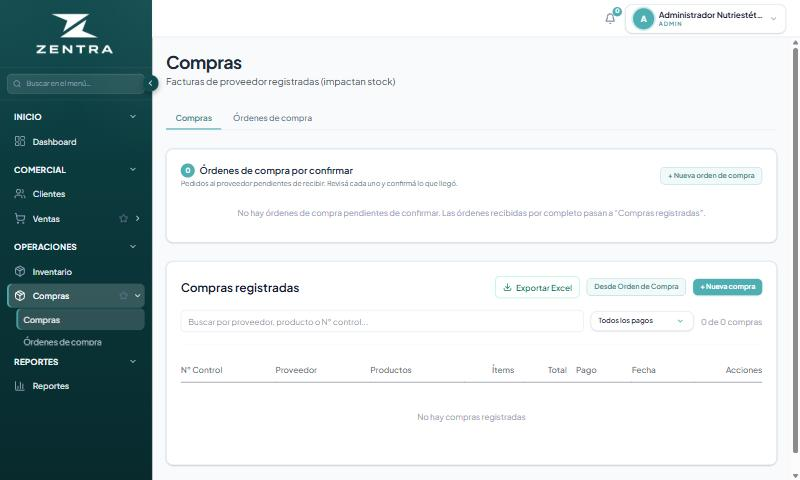

---

## Paso 2 — Registrar un nuevo proveedor

Antes de cargar una compra necesitás que el proveedor exista.

1. En el menú, entrá a **Compras → Proveedores**.
2. Tocá el botón verde **+ Nuevo proveedor** (arriba a la derecha).

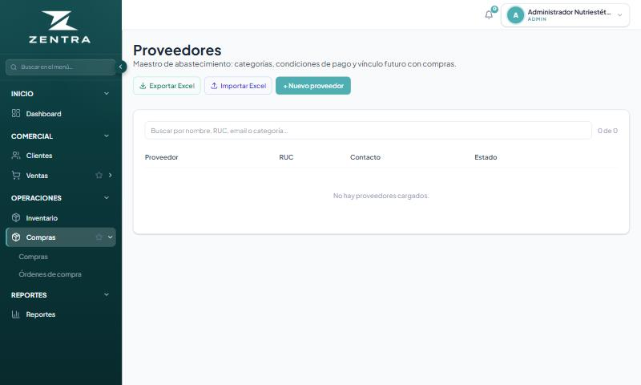

3. Completá el formulario. Los campos marcados con `*` son obligatorios.

Campos recomendados:

| Campo | Qué poner |
|---|---|
| **Razón social / Nombre del proveedor \*** | Nombre legal del proveedor (se guarda en MAYÚSCULAS). |
| **RUC** | Opcional. RUC del proveedor. |
| **Nombre comercial** | Si difiere del razón social. |
| **Teléfono / Email / Dirección** | Datos de contacto. |
| **Contacto principal** | Persona a cargo. |
| **Estado** | Dejá **Activo**. |
| **Condición de pago habitual** | Contado, Crédito o Mixto. |
| **Plazo (días)** | Si trabajás a crédito, los días habituales. |
| **Moneda preferida** | Guaraníes (GS) o Dólares (USD). |

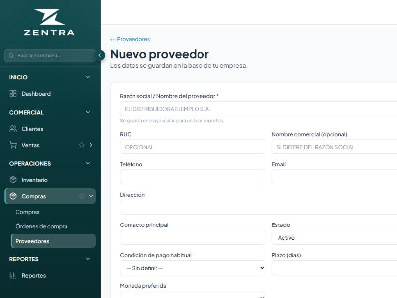

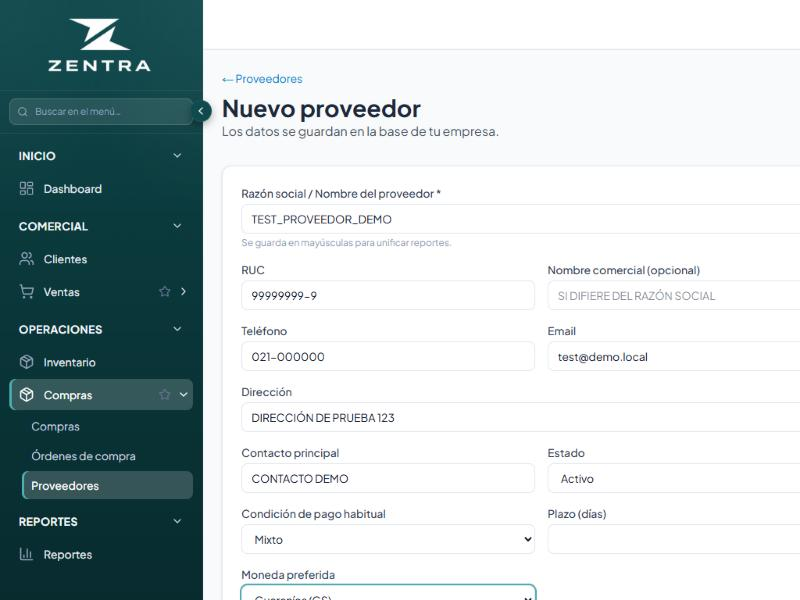

4. Tocá el botón **Guardar** al pie del formulario.

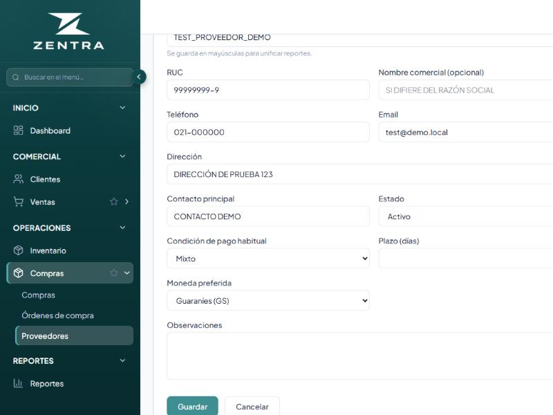

5. Volvés a la lista y vas a ver el nuevo proveedor dado de alta. Desde ahí podés **Editar** o **Borrar** si hace falta.

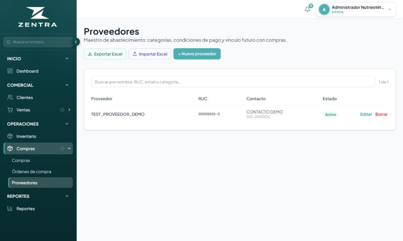

---

## Paso 3 — Registrar una nueva compra

1. Entrá a **Compras → Compras**.
2. Tocá el botón verde **+ Nueva compra** (arriba a la derecha).

Se abre el formulario con cuatro bloques: **Comprobante y proveedor**, **Condiciones y moneda**, **Productos de la compra** y los botones finales.

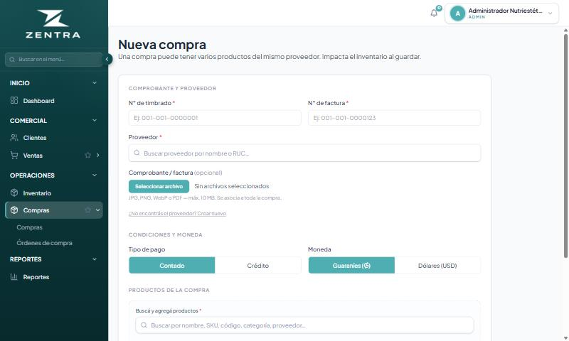

### 3.1 Comprobante y proveedor

- **N° de timbrado** `*` — el que figura en la factura del proveedor.
- **N° de factura** `*` — número del comprobante.
- **Proveedor** `*` — empezá a escribir el nombre o el RUC; el sistema te muestra una lista con los que coinciden. Hacé clic en el correcto para seleccionarlo.

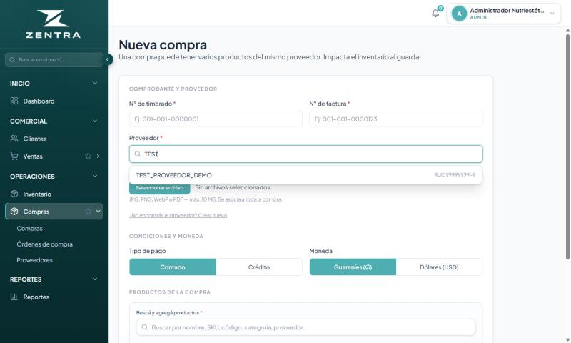

- **Comprobante / factura (opcional)** — podés adjuntar la imagen o el PDF de la factura (JPG, PNG, WebP o PDF, máximo 10 MB). Se asocia a toda la compra.

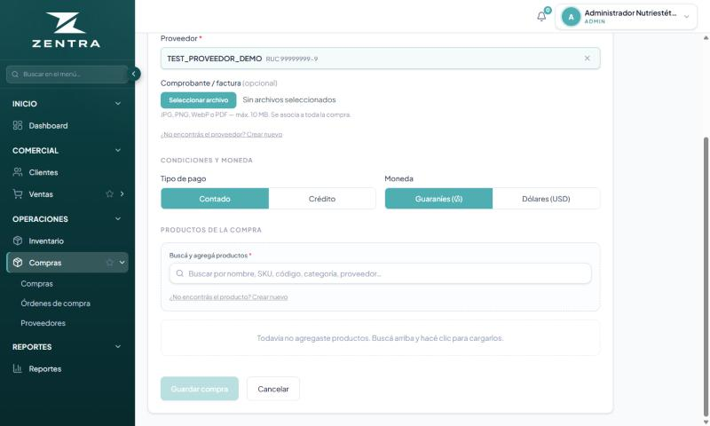

> Si el proveedor aún no está cargado, tocá **¿No encontrás el proveedor? Crear nuevo** y hacé el Paso 2 desde ahí.

### 3.2 Condiciones y moneda

- **Tipo de pago**: elegí **Contado** o **Crédito**.
  - Si elegís **Crédito**, aparece el campo **Plazo (días)** para indicar en cuántos días se vence la cuenta por pagar.
- **Moneda**: Guaraníes (GS) o Dólares (USD).

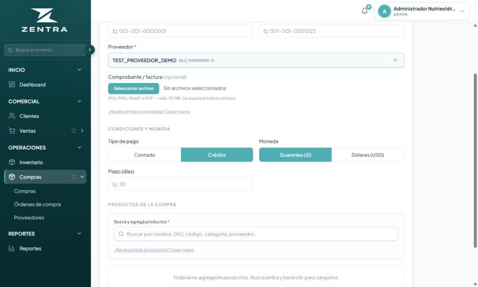

### 3.3 Productos de la compra

1. En el buscador **"Buscá y agregá productos"** escribí el nombre, SKU, código o categoría del producto.
2. El sistema muestra las coincidencias con **stock actual** y **costo** entre paréntesis.
3. Tocá el producto para agregarlo al detalle de la compra.

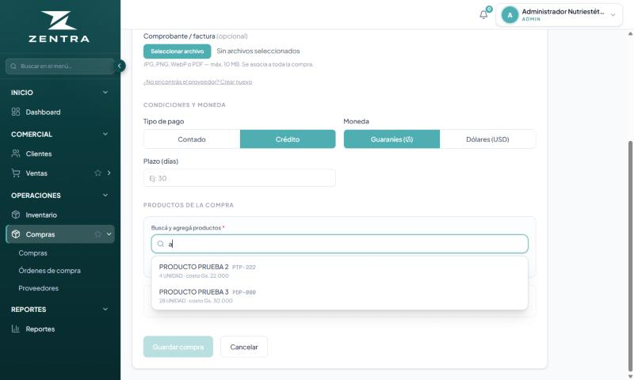

4. Una vez agregado, podés ajustar **cantidad** y **costo unitario** por renglón. El total se recalcula en vivo.
5. Agregá tantos productos como vengan en la factura del proveedor.

> Si el producto no existe, tocá **¿No encontrás el producto? Crear nuevo**.

### 3.4 Guardar la compra

Cuando el formulario esté completo, el botón **Guardar compra** se habilita. Al tocarlo:

- Se registra la factura de compra con todos sus productos.
- **Siempre**: el stock de los productos sube en la cantidad cargada y el costo de cada producto se actualiza según el costo unitario de la compra.
- **Contado**: se registra el egreso en caja al momento.
- **Crédito**: se genera una **cuenta por pagar** con el plazo indicado, y la caja **no** se mueve hasta que registres el pago.

---

## Paso 4 — Pagar una compra a crédito

1. Entrá a **Compras → Compras** y ubicá la compra a crédito en la lista.
2. Tocá **Ver detalle** sobre la fila correspondiente.
3. Desde el detalle vas a ver el **saldo pendiente** y el botón **Registrar pago**.
4. Al registrar el pago se descuenta de la caja y el saldo de la cuenta por pagar se reduce (o se cancela, si pagás el total).

> Para pagos parciales, cargá el monto efectivamente abonado; el saldo restante queda pendiente hasta el próximo pago.

---

## Paso 5 — Consultar el historial

En **Compras → Compras** tenés:

- **Buscador** por proveedor, producto o N° de control.
- **Filtro** por tipo de pago (Contado / Crédito / Todos).
- **Exportar Excel** para bajar el listado.
- Columnas: N° Control, Proveedor, Productos, Ítems, Total, Pago, Fecha, Acciones (Ver, Editar, Anular).

En **Compras → Órdenes de compra** quedan los pedidos pendientes al proveedor. Cuando la mercadería llega, convertís la orden en compra con el botón **Desde Orden de Compra** del listado principal.

---

## Checklist que debería cumplirse después de cada compra

Esto te sirve como control para que no haya duplicaciones ni errores:

- [ ] El producto aparece con más stock (sumá la cantidad comprada).
- [ ] Si fue **contado**, hay un egreso en caja por el total.
- [ ] Si fue **crédito**, NO hay egreso en caja; aparece una cuenta por pagar.
- [ ] En el detalle de la compra figuran todos los productos y el total coincide con la factura del proveedor.
- [ ] En **Inventario → Movimientos** del producto aparece un ingreso con origen "Compra N°…".

Si algo de esto no coincide, no vuelvas a cargar la compra: avisá a soporte con el **N° de control** de la compra.

---

## Soporte

Ante cualquier duda o diferencia en stock/caja, contactá a soporte y adjuntá:
- N° de control de la compra.
- Captura del detalle.
- Descripción de lo esperado vs lo que ves.
